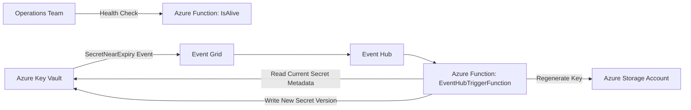
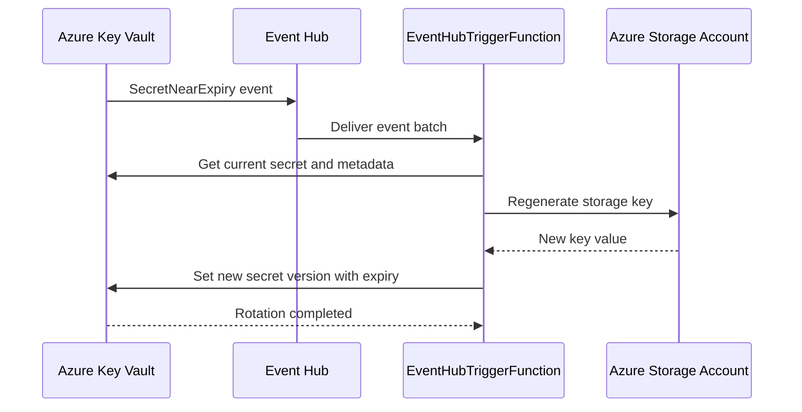

# KSSEDR

Key Vault Serverless Secret Event Driven Rotation.

## Project Status

Status: Maintained

This project is actively maintained. Issues and pull requests are reviewed regularly.

Last updated: 2026-04-26

## Maintenance Policy

- Bug fixes and compatibility updates are accepted.
- Pull requests are welcome for documentation, reliability, and operational improvements.
- If you plan a larger change, open an issue first to align on approach.

## Overview

KSSEDR is an Azure Functions-based solution for event-driven secret rotation workflows with Azure Key Vault.

## Why Rotation Is Needed

Secret rotation reduces the lifetime of exposed credentials and limits blast radius if a secret is leaked.

Key reasons to rotate secrets:

- Security risk reduction: short-lived secrets lower the impact of accidental exposure.
- Compliance requirements: many standards require periodic credential rotation.
- Operational resilience: automated rotation avoids outages caused by expired credentials.
- Human error reduction: event-driven automation removes manual, error-prone rotation steps.
- Auditability: each rotation can be tracked through logs and secret version history.

Without rotation, long-lived storage keys and connection strings become high-value targets and increase incident recovery time.

## Architecture

The solution listens for Key Vault near-expiry events and rotates supported secrets through an Azure Function.



### Rotation Sequence



The function app currently includes:

- `EventHubTriggerFunction`: consumes Key Vault near-expiry events from Event Hub and rotates supported secrets.
- `IsAlive`: lightweight HTTP endpoint for health checks and runtime metadata.

## Runtime and Tech Stack

- .NET: net6.0
- Azure Functions runtime: v4
- Trigger: Event Hub
- Secret store: Azure Key Vault

## Configuration

Set these app settings for the function app:

- `EventHub.ConnectionString`: Event Hub connection string for the trigger.
- `tenantId`: Microsoft Entra tenant ID used for authentication.
- `clientId`: application (or managed identity client) ID.
- `clientSecret`: client secret when using service principal auth.
- `REGION_NAME`: optional region label returned by the `IsAlive` endpoint.

Note: the current implementation contains comments for switching from client-secret auth to managed identity.

## Local Development

Prerequisites:

- .NET 6 SDK
- Azure Functions Core Tools v4

Build:

```bash
dotnet build src/Az.KeyVault.AutoRotate/Az.KeyVault.AutoRotate.csproj
```

Run locally:

```bash
func start --csharp --script-root src/Az.KeyVault.AutoRotate
```

## Deployment and IaC

- Function app implementation: `src/Az.KeyVault.AutoRotate/`
- Bicep/deployment project samples: `src/Rg.FunApp/` and `src/RG.UseExample/`

## Event Example

Sample Key Vault event payload is available in `payloda.txt`.
